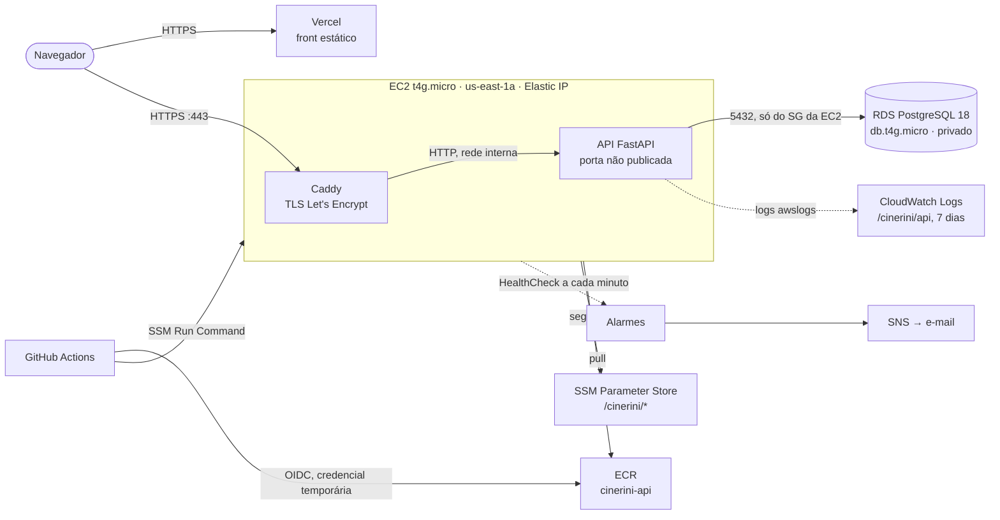

# Deploy na AWS

API em uma EC2 atrás do Caddy, banco no RDS, imagem no ECR, deploy pelo GitHub Actions sem chave de acesso. Toda a infraestrutura está em `infra/` (Terraform) e o que roda na máquina em `deploy/`. O porquê das escolhas está em `docs/DECISOES.md`, D38.

O front continua na Vercel, e o Render segue configurado (`render.yaml`) como reserva.

## Arquitetura



| Peça | Recurso | Arquivo |
|---|---|---|
| Rede | VPC padrão, SG da API (80/443 públicas, 22 só do IP do administrador), SG do banco (5432 só do SG da API) | `infra/network.tf` |
| Máquina | EC2 t4g.micro, Amazon Linux 2023 arm64, IMDSv2 obrigatório, créditos de CPU `standard`, Elastic IP | `infra/ec2.tf` |
| Preparo da máquina | Docker, Compose fixo, 1 GB de swap, timer de saúde | `infra/user_data.sh.tftpl` |
| Banco | RDS PostgreSQL 18, gp3 20 GB criptografado, sem IP público, backup de 1 dia | `infra/rds.tf` |
| Imagens | ECR com tag imutável, varredura no push, retém as cinco últimas | `infra/ecr.tf` |
| Permissões | Role de deploy por OIDC, role da EC2 | `infra/github_oidc.tf`, `infra/ec2_role.tf` |
| Observabilidade | Log group, alarmes, tópico SNS, painel com SLO | `infra/monitoring.tf`, `infra/dashboard.tf` |
| Demonstração | Reset diário: Scheduler → Lambda → SSM | `infra/demo_reset.tf`, `infra/lambda/` |
| Estado | Bucket S3 versionado, trava nativa | `infra/bootstrap/` |
| Runtime | Compose de produção, Caddyfile, script de deploy | `deploy/` |
| Pipeline | Testes → build arm64 → varredura → deploy | `.github/workflows/deploy-aws.yml` |
| Verificação da infra | fmt, validate, tflint, checkov | `.github/workflows/infra.yml` |

Endereço: `https://<ip-com-hífens>.sslip.io`, saída `api_domain` do Terraform. O sslip.io resolve o nome para o IP contido nele, o que dá ao Let's Encrypt um domínio válido sem registro próprio.

## Custo

Estimativa mensal em `us-east-1`, preço de tabela, antes de créditos:

| Recurso | US$/mês |
|---|---|
| RDS db.t4g.micro | 11,70 |
| RDS gp3 20 GB | 2,30 |
| EC2 t4g.micro | 6,10 |
| IPv4 público | 3,65 |
| EBS gp3 10 GB | 0,80 |
| ECR, logs, duas métricas customizadas, alarmes, SNS | ~0,70 |
| Bucket do estado, Lambda, Scheduler, painel | ~0,01 |
| **Total** | **~25** |

Ficam de fora de propósito: NAT Gateway (~32), Load Balancer (~16), Multi-AZ (dobra o RDS), endpoints de VPC (~7 cada). Parameter Store padrão, a chave `aws/ssm` e até dez alarmes não cobram.

A conta usa o plano gratuito com créditos, que limita a retenção de backup do RDS a um dia e encerra a conta ao fim do período se não houver upgrade.

## Segredos

| Parâmetro | Tipo | Origem |
|---|---|---|
| `/cinerini/secret-key` | SecureString | gerado à mão; assina sessões e QR. Trocá-lo invalida todo ingresso emitido |
| `/cinerini/db-password` | SecureString | gerado à mão; lido pelo Terraform por `ephemeral` e enviado ao RDS por `password_wo`, nunca gravado no estado |
| `/cinerini/tmdb-api-key` | SecureString | chave do TMDb |
| `/cinerini/cors-origins` | String | domínio do front |
| `/cinerini/db-host` | String | escrito pelo Terraform |

Os quatro primeiros existem antes do `terraform apply` e não são gerenciados por ele, para que nenhum valor passe pelo `terraform.tfstate`. Criação, sem o valor aparecer na tela nem no histórico:

```powershell
$v = python -c "import secrets; print(secrets.token_urlsafe(48))"
aws ssm put-parameter --name /cinerini/secret-key --type SecureString --value $v
$v = python -c "import secrets; print(secrets.token_urlsafe(32))"
aws ssm put-parameter --name /cinerini/db-password --type SecureString --value $v
Remove-Variable v
```

A senha do banco usa só `[A-Za-z0-9_-]` porque entra na `DATABASE_URL` sem escape. Trocar a senha: atualizar o parâmetro com `--overwrite`, incrementar `db_password_version` e aplicar. Trocar qualquer segredo da aplicação: atualizar o parâmetro e refazer o deploy, que regenera o `.env.api`.

## Subir do zero

Pré-requisitos: AWS CLI 2.32+ autenticada (`aws login`), Terraform 1.11+, um par de chaves em `~/.ssh/cinerini-aws`.

1. Criar os quatro parâmetros acima.
2. Bucket do estado, uma vez: `terraform init && terraform apply` em `infra/bootstrap/`. Em outra conta, ajustar o nome do bucket no backend de `infra/versions.tf`.
3. `infra/terraform.tfvars` a partir do `.example`: IP do administrador com `/32` e e-mail dos alarmes.
4. `terraform init && terraform apply` em `infra/`. Leva de 5 a 10 minutos, quase todos esperando o RDS.
5. Confirmar a assinatura do SNS no e-mail recebido.
6. Conferir que o `sub` em `github_oidc_subject` corresponde ao repositório. O GitHub emite `repo:<dono>@<id>/<repo>@<id>:ref:refs/heads/main`; um token recusado aparece no CloudTrail como `AssumeRoleWithWebIdentity` com `AccessDenied`, e o campo `userName` traz o `sub` exato.
7. Ajustar `ROLE_ARN` em `deploy-aws.yml` se a conta for outra, e fazer push na `main`.
8. Semear uma vez, de dentro da instância:

```bash
cd /opt/cinerini && docker compose -f docker-compose.prod.yml run --rm api python -m app.seed
```

9. Na Vercel, `VITE_API_URL` com a saída `api_domain` (com `https://`), e redeploy do front.

## Deploy

Push na `main` que altere `api/`, `deploy/` ou os workflows dispara `deploy-aws.yml`:

1. **test**: chama `ci.yml`, a suíte inteira num Postgres 18 de serviço. Falhou, nada é publicado.
2. **build**: runner `ubuntu-24.04-arm`, porque a EC2 é Graviton. `--pull` para partir da base mais recente. Imagem marcada com o SHA completo do commit.
3. **varredura**: Trivy na imagem, antes do push. Vulnerabilidade HIGH ou CRITICAL **com correção disponível** reprova, e a imagem não chega ao ECR, nem para rollback. Sem correção disponível não reprova, porque travaria todo deploy sem dar a ninguém o que fazer.
4. **deploy**: localiza a instância pela tag `Project=cinerini` e envia, por SSM Run Command, um comando que baixa `deploy/` do mesmo commit e executa `deploy.sh`. O script regenera `.env` e `.env.api` a partir do Parameter Store, aplica `alembic upgrade head`, troca os contêineres com `up -d --wait` e confere `/health` por HTTPS pelo domínio público.

**Rollback automático.** Se a versão nova sobe mas não responde por HTTPS, o `deploy.sh` volta sozinho para a imagem que estava no ar e termina com erro, deixando o workflow vermelho. Cobre a falha que só aparece depois da troca: configuração, certificado, rota quebrada.

A migration antes da troca é o que preserva a versão anterior no ar quando ela falha. O rollback automático não a desfaz, e por isso migration que remove ou renomeia coluna precisa ser feita em dois deploys: primeiro o código que não usa mais a coluna, depois a migration.

A role de deploy só aceita a `main` deste repositório, só envia imagem para `cinerini-api` e só manda comando para instância com a tag do projeto, pelo documento `AWS-RunShellScript`.

Dependências: o Dependabot abre um PR semanal por ecossistema (pip, npm, Docker, Actions, Terraform), e correção de segurança fora do calendário.

## Rollback manual

*Actions → deploy-aws → Run workflow*, com o SHA completo de um commit cuja imagem ainda esteja no ECR (as cinco mais recentes):

```bash
aws ecr describe-images --repository-name cinerini-api \
  --query 'sort_by(imageDetails,&imagePushedAt)[].imageTags[0]' --output text
```

Testes e build são pulados, e compose e script vêm do mesmo commit da imagem. **Migration não é desfeita**: voltar para antes de uma migration exige `alembic downgrade` manual na instância antes do rollback.

## Infraestrutura como código

Estado em `s3://cinerini-tfstate-<conta>/infra/terraform.tfstate`, versionado, com trava nativa (`use_lockfile`): dois applies simultâneos não se sobrescrevem. O bucket vem de `infra/bootstrap/`, com estado local e `prevent_destroy`.

`infra.yml` verifica todo PR e push que toque em `infra/`: `fmt`, `validate`, `tflint` e `checkov`. Sem plan e sem credencial: o plan lê a senha do banco (recurso `ephemeral`), e rodá-lo no CI daria a uma role de PR acesso ao segredo. As exceções do checkov estão em `infra/.checkov.yaml`, cada uma com o motivo, quase todas por custo (chave KMS própria, Multi-AZ, retenção longa).

## Dados de demonstração

As contas de teste são públicas, e quem entra como organizador pode apagar o que quiser. Em vez de restringir a conta, o estado volta ao do seed todo dia às 4h (Brasília): o EventBridge Scheduler chama a Lambda `cinerini-reset-demo`, que manda a instância rodar o seed por SSM e espera o resultado. Falha vira o alarme `cinerini-reset-demo-falhou`. A Lambda não fala com o banco: sem VPC, sem driver, sem senha.

O mesmo reset recalcula as sessões a partir do dia, que de outro modo venceriam em três semanas. Rodar à mão:

```bash
aws lambda invoke --function-name cinerini-reset-demo resposta.json
```

## Proteção contra abuso

| Camada | O que segura |
|---|---|
| Shield Standard (automático) | ataque de rede: SYN e UDP flood, reflexão |
| Security Group | só 80 e 443 abertas; 22 só do administrador; banco sem IP público |
| Teto por IP na API | 300 requisições por minuto em qualquer rota, `429` com `Retry-After` |
| Limite de login e cadastro | 60 logins por IP em 5 min, 8 por conta em 15 min, 20 cadastros por IP por hora |
| Teto de requisições em andamento | 30 dentro da aplicação; o excedente espera em fila sem segurar conexão (D39) |
| Créditos de CPU `standard` | sob ataque a máquina fica lenta, mas não gera cobrança |
| Alarmes | saúde, CPU, 5xx, tráfego de saída acima de 1 GB por hora |

**Emergência:** `terraform apply -var lockdown=true` fecha 80 e 443 para todos, menos `admin_cidr`. O site sai do ar para o mundo e segue acessível para investigar. Desfazer com `lockdown=false`. WAF não foi usado: o mínimo dele custa mais que a aplicação inteira, para proteger um ambiente sem dado real.

## Acesso à instância

- **Session Manager:** console → EC2 → instância → *Conectar* → *Session Manager*, ou `aws ssm start-session --target <instance_id>` com o plugin instalado. Não usa porta.
- **SSH:** saída `ssh_command` do Terraform. Só aceita o IP em `admin_cidr`; com IP novo, atualizar o `terraform.tfvars` e aplicar.

Arquivos em `/opt/cinerini`. `.env.api` tem permissão 600.

## Observabilidade

A API escreve uma linha JSON por requisição (`app/request_log.py`): método, **modelo** da rota (`/events/{event_id}`, não o caminho), status, duração em ms e IP. O `/health` fica de fora, porque seria a maior parte do volume. Logs dos contêineres no log group `/cinerini/api`, retenção de sete dias. Pelo terminal: `aws logs tail /cinerini/api --follow`.

**Painel** `cinerini` no CloudWatch (saída `dashboard_url`): disponibilidade contra o SLO, saúde minuto a minuto, latência p50/p95/p99 por rota, requisições por classe de status, CPU e créditos da EC2, CPU, conexões e disco do RDS.

**SLO: 99% dos minutos com `/health` respondendo por HTTPS, em 30 dias.** Orçamento de erro de 432 minutos por mês. A disponibilidade é minutos bons sobre os minutos do intervalo, e não sobre os minutos que chegaram: minuto sem dado conta contra.

| Alarme | Condição |
|---|---|
| `cinerini-api-health` | `GET /health` por HTTPS falhando por 3 minutos, ou métrica ausente |
| `cinerini-api-5xx` | cinco ou mais respostas 5xx em 5 minutos, contadas na linha JSON |
| `cinerini-ec2-status` | `StatusCheckFailed` por 2 minutos |
| `cinerini-ec2-cpu` | CPU média acima de 80% por 15 minutos |
| `cinerini-ec2-trafego-saida` | mais de 1 GB de saída em uma hora |
| `cinerini-reset-demo-falhou` | o reset diário terminou com erro |

A métrica de saúde é publicada pela própria instância, a cada minuto, pelo timer `cinerini-health`, acessando o domínio público: cobre DNS, certificado, Caddy e API. Ausência de dado conta como falha, porque máquina parada não publica nada.

## Recuperação do banco

`infra/scripts/testar-restauracao.ps1` restaura o RDS para o último ponto restaurável numa instância temporária, conta usuários, eventos, sessões e ingressos nela pela EC2 e apaga a instância. Mede o RPO (distância até o último ponto restaurável) e o RTO (do pedido até a instância aceitar conexão). Custa menos de US$ 0,05 por execução.

O backup automático guarda um dia, o máximo do plano gratuito: a restauração alcança qualquer minuto das últimas 24 horas.

## Teste de carga

`loadtest/`, com k6:

- `corrida.js`: N clientes reservando **a mesma poltrona** ao mesmo tempo, direto na API. Exatamente um pode vencer. A preparação (`loadtest/preparar.py`) cria os clientes e emite os tokens dentro do contêiner da API.
- `leitura.js`: latência de `GET /events` com 4 usuários por um minuto, abaixo do teto por IP.

Corrida com 500 clientes, no compose de produção local: **1 reserva aceita, 499 recusadas com 409, nenhum outro status, 1 ingresso no banco**. A primeira execução travou tudo até o tempo limite do pool; o defeito está na D39.

## Apagar tudo

```bash
cd infra && terraform destroy
```

Remove EC2, Elastic IP, RDS (sem snapshot final), ECR com as imagens, roles, OIDC, Lambda, Scheduler, alarmes, painel, SNS e log groups. Sobram, por não serem do Terraform de `infra/`:

- os quatro parâmetros criados à mão: `aws ssm delete-parameters --names /cinerini/secret-key /cinerini/db-password /cinerini/tmdb-api-key /cinerini/cors-origins`;
- o bucket do estado, protegido por `prevent_destroy`: remover a linha em `infra/bootstrap/main.tf`, `terraform destroy` lá, e esvaziar as versões do bucket se o destroy recusar;
- as métricas customizadas, que expiram sozinhas sem novos dados e param de cobrar.

Antes de destruir, o front precisa voltar para o Render, ou fica sem API.

Conferência de sobra, por tag:

```bash
aws resourcegroupstaggingapi get-resources --tag-filters Key=Project,Values=cinerini
```
